<picture><source media="(prefers-color-scheme: dark)" srcset="assets/hero-dark.svg"></picture>

<picture><source media="(prefers-color-scheme: dark)" srcset="assets/about-dark.svg"></picture>

<picture><source media="(prefers-color-scheme: dark)" srcset="assets/stack-dark.svg"></picture>

<a href="https://github.com/pomedorkaaa/moldcell-practice"><picture><source media="(prefers-color-scheme: dark)" srcset="assets/project-moldcell-practice-dark.svg"></picture></a>&nbsp;<a href="https://github.com/pomedorkaaa/jasmine-dragon"><picture><source media="(prefers-color-scheme: dark)" srcset="assets/project-jasmine-dragon-dark.svg"></picture></a>

<a href="https://github.com/pomedorkaaa/tech-md-front"><picture><source media="(prefers-color-scheme: dark)" srcset="assets/project-tech-md-front-dark.svg"></picture></a>&nbsp;<a href="https://github.com/pomedorkaaa/s-terra-landing"><picture><source media="(prefers-color-scheme: dark)" srcset="assets/project-s-terra-landing-dark.svg"></picture></a>

<picture><source media="(prefers-color-scheme: dark)" srcset="assets/stats-dark.svg"></picture>

<picture><source media="(prefers-color-scheme: dark)" srcset="assets/wave-dark.svg"></picture>

<a href="mailto:realitzegor@gmail.com"><picture><source media="(prefers-color-scheme: dark)" srcset="assets/button-1-dark.svg"></picture></a>&nbsp;&nbsp;<a href="https://github.com/pomedorkaaa?tab=repositories"><picture><source media="(prefers-color-scheme: dark)" srcset="assets/button-2-dark.svg"></picture></a>

<a href="https://metawka.github.io/expressive-profile/?from=pomedorkaaa"><picture><source media="(prefers-color-scheme: dark)" srcset="assets/credit-dark.svg"></picture></a>

